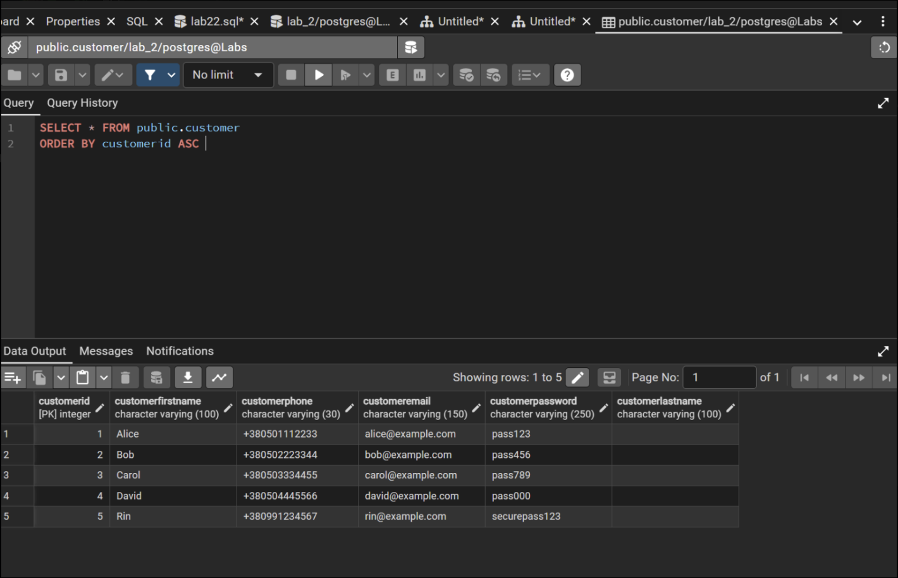
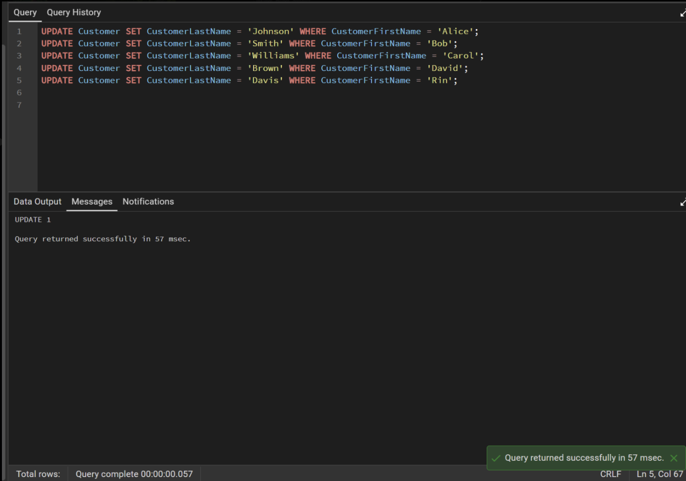
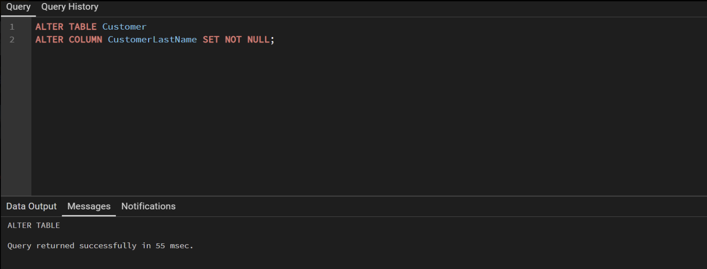

# Лабораторна робота 4: Аналітичні SQL-запити (OLAP)

**Мета:** покращити цілісність даних та усунути їхню надлишковість шляхом покрокової нормалізації існуючої схеми бази даних до Третьої нормальної форми (3НФ), щоб кожен факт зберігався лише один раз без аномалій вставки, оновлення та видалення.

**Цілі:**
- виявити потенційну надлишковість даних та аномалії (вставки, оновлення, видалення) у початковій схемі БД;
- визначити та задокументувати повний мінімальний набір функціональних залежностей (ФЗ) для таблиць;
- oцінити поточну нормальну форму (1NF, 2NF, 3NF) кожної таблиці на основі її ключів та ФЗ;
- провести покрокову декомпозицію таблиць до 3НФ (усунувши повторювані групи, часткові та транзитивні залежності);
- оновити SQL-скрипти (`CREATE TABLE` / `ALTER TABLE`) у `PostgreSQL`, оновити ER-діаграму та перевірити цілісність даних на тестових прикладах.

## Перехід до 1НФ

**Попередня таблиця:** 

| № | Customer| 
|---|---|
| 1 | CustomerID |
| 2 | CustomerName |
| 3 | CustomerPhone |
| 4 | CustomerEmail |
| 5 | CustomerPassword |

**Проблема:** `CustomerName` за вимогами має містити прізвище та імʼя, а це не відповідає критерію атомарності атрибутів.

**Кроки змін:**

1. Перейменування `CustomerName` на `CustomerFirstName`

2. Додали `CustomerLastName`

3. Додали прізвища всім наявним клієнтам в базі

4. Задали обмеження для атрибуту `CustomerLastName` - `not null`

**Таблиця після змін:**

| № | Customer| 
|---|---|
| 1 | CustomerID |
| 2 | CustomerName |
| 3 | CustomerLastName |
| 4 | CustomerPhone |
| 5 | CustomerEmail |
| 6 | CustomerPassword |

**Попередня таблиця:**

| № | Order | 
|---|---|
| 1 | OrderID |
| 2 | CustomerID |
| 3 | OrderDeliveryPlace |
| 4 | OrderPrice |

**Проблема:** `OrderDeliveryPlace` за вимогами має містити країну та поштовий індекс, а це не відповідає критерію атомарності атрибутів.

**Зміна:** додаєм атрибут `PostCode`, який міститиме поштовий індес, а `OrderDeliveryPlace` міститиме країну доставки.

**Таблиця після змін:**

| № | Order | 
|---|---|
| 1 | OrderID |
| 2 | CustomerID |
| 3 | OrderDeliveryPlace |
| 4 | OrderPrice |
| 5 | PostCode |

