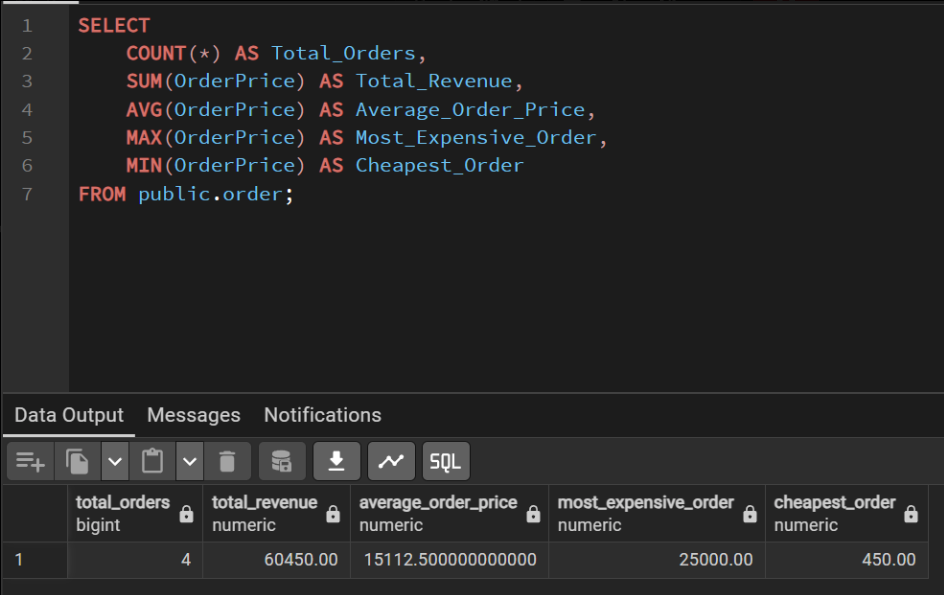
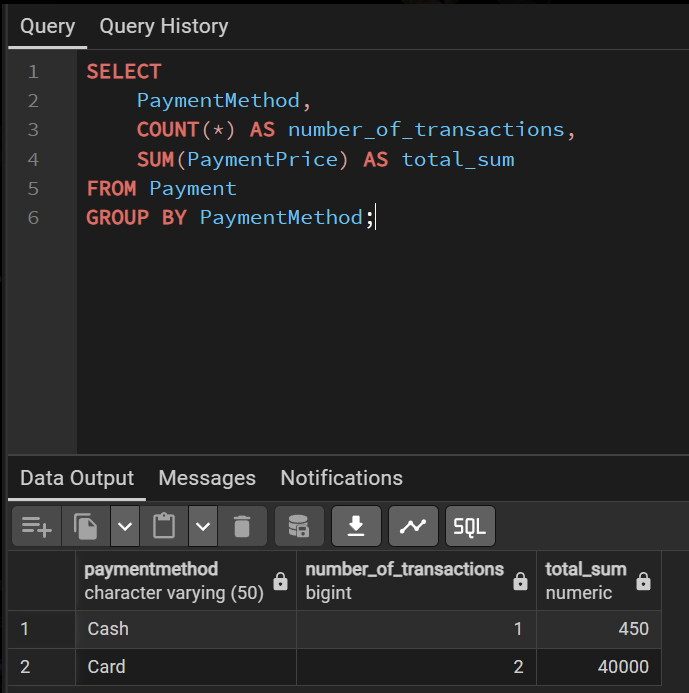
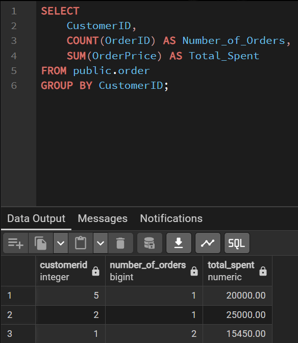
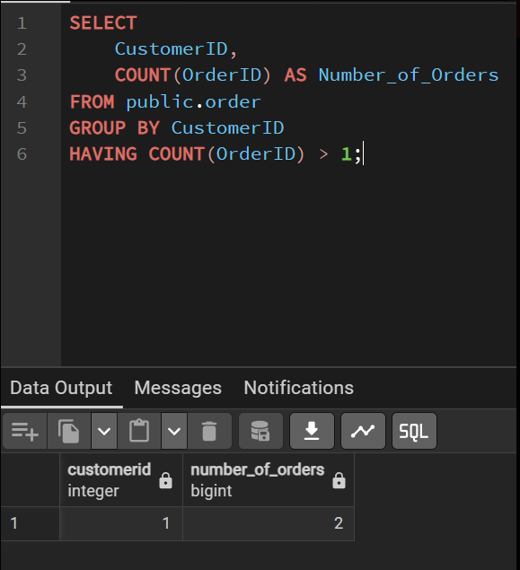

# Лабораторна робота 4: Аналітичні SQL-запити (OLAP)

**Мета:** опанувати написання аналітичних SQL-запитів (OLAP) у СКБД PostgreSQL (середовище pgAdmin) для аналізу даних, виявлення закономірностей та формування зведеної звітності на основі раніше спроєктованої бази даних.

**Цілі:**
- навчитися застосовувати базові агрегатні функції (`COUNT`, `SUM`, `AVG`, `MIN`, `MAX`) для аналізу числових показників;
- освоїти оператор `GROUP BY` для розбиття записів на логічні групи за одним або кількома стовпцями;
- навчитися використовувати речення `HAVING` для відбору груп, що відповідають заданим умовам агрегації;
- закріпити навички роботи з різними типами операцій `JOIN` (`INNER JOIN`, `LEFT JOIN`, `RIGHT JOIN`, `FULL JOIN`, `CROSS JOIN`) для зведення даних із кількох пов'язаних таблиць;
- навчитися комбінувати об'єднання таблиць з агрегацією, а також використовувати вкладені підзапити в конструкціях `SELECT`, `WHERE` та `HAVING`.

## Агрегаційні функції (`SUM`, `AVG`, `COUNT`, `MIN`, `MAX`, `GROUP BY`)

### Запит 1.1: загальна фіансова статистика
```sql
SELECT 
    COUNT(*) AS Total_Orders,
    SUM(OrderPrice) AS Total_Revenue,
    AVG(OrderPrice) AS Average_Order_Price,
    MAX(OrderPrice) AS Most_Expensive_Order,
    MIN(OrderPrice) AS Cheapest_Order
FROM public.order;
```

**Мета:** дозволяє швидко оцінити загальний обсяг продажів магазину та діапазон цін.

**Що робить:** обчислює зведені фінансові показники по всій таблиці замовлень (public.order) одним рядком: кількість операцій, суму, середнє арефметичне, максимальне та мінімільне значення.

**Результат:** 


### Запит 1.2: розподіл транзакцій за способами оплати
```sql
SELECT 
    PaymentMethod,
    COUNT(*) AS number_of_transactions,
    SUM(PaymentPrice) AS total_sum
FROM Payment
GROUP BY PaymentMethod;
```
**Мета:** проаналізувати популярність різних платіжних методів

**Що робить:** рахує кількість операцій та суму операцій і групує за методом оплати

**Результат:** 


### Запит 1.3: активність та витрати кожного клієнта
```sql
SELECT 
    CustomerID,
    COUNT(OrderID) AS Number_of_Orders,
    SUM(OrderPrice) AS Total_Spent
FROM public.order
GROUP BY CustomerID;
```
**Мета:** формування профілю купівельної активності кожного клієнта

**Що робить:** рахує кількість замоалень клієнта та загальну суму витрат в магазині

**Результат:** 


### Запит 1.4: пошук постійних клієнтів
```sql
SELECT 
    CustomerID,
    COUNT(OrderID) AS Number_of_Orders
FROM public.order
GROUP BY CustomerID
HAVING COUNT(OrderID) > 1;
```
**Мета:** відсіяти одноразових покупців і залишитиі лише тих клієнтів, які повернулися та зробили більше одного замовлення (аналіз повторних покупок).

**Що робить:** рахує кількість замовлень клієнта та обирає клієнтів, які робили більше одного замовлення

**Результат:** 
